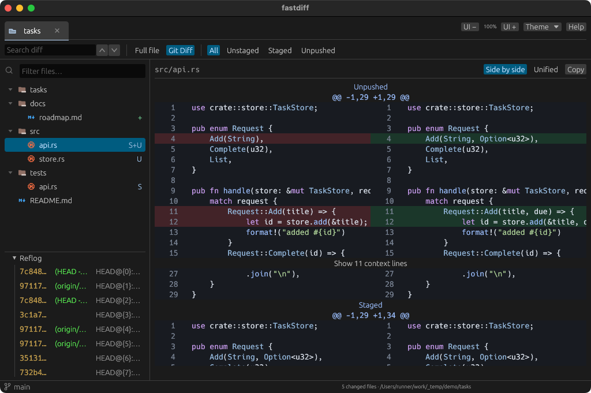
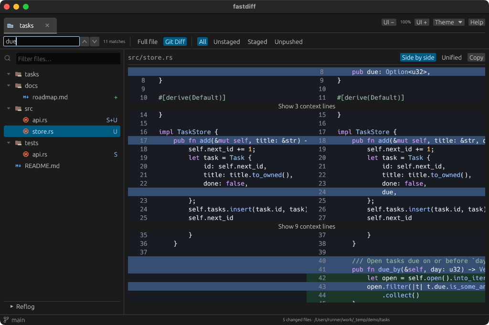
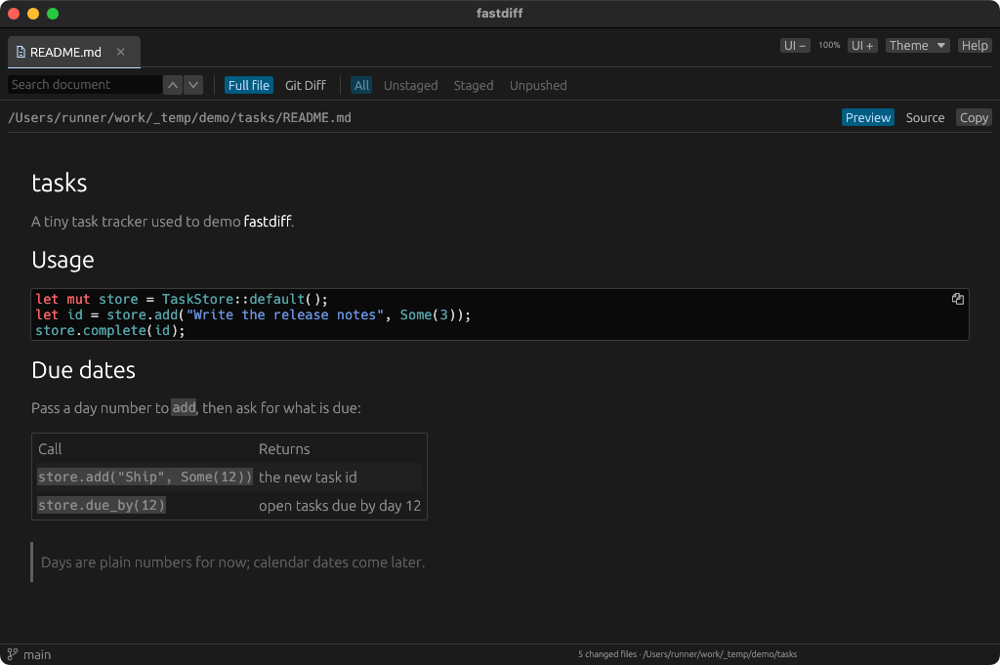
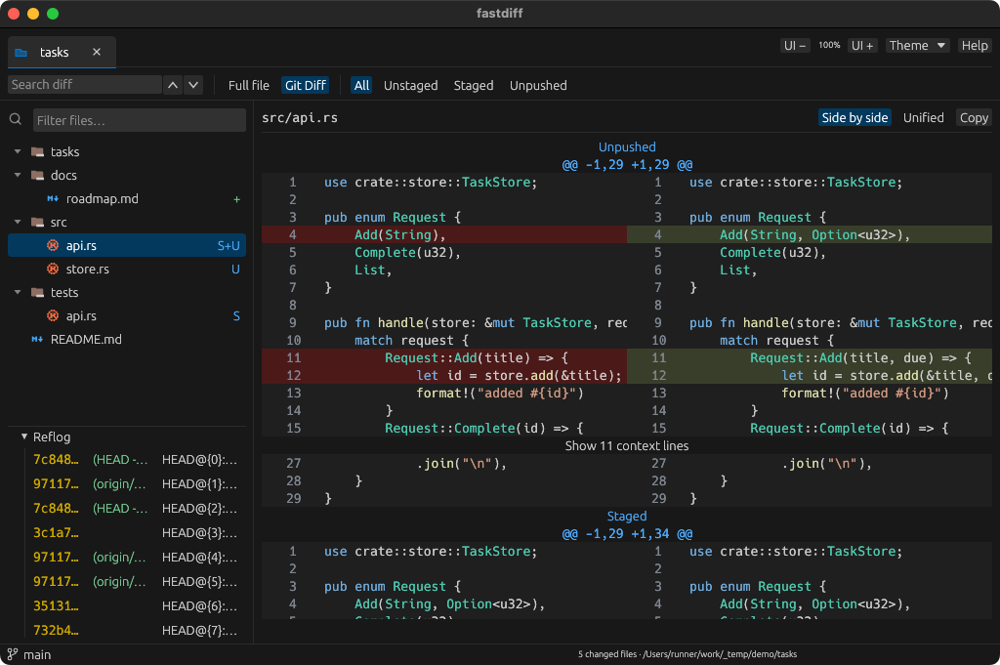
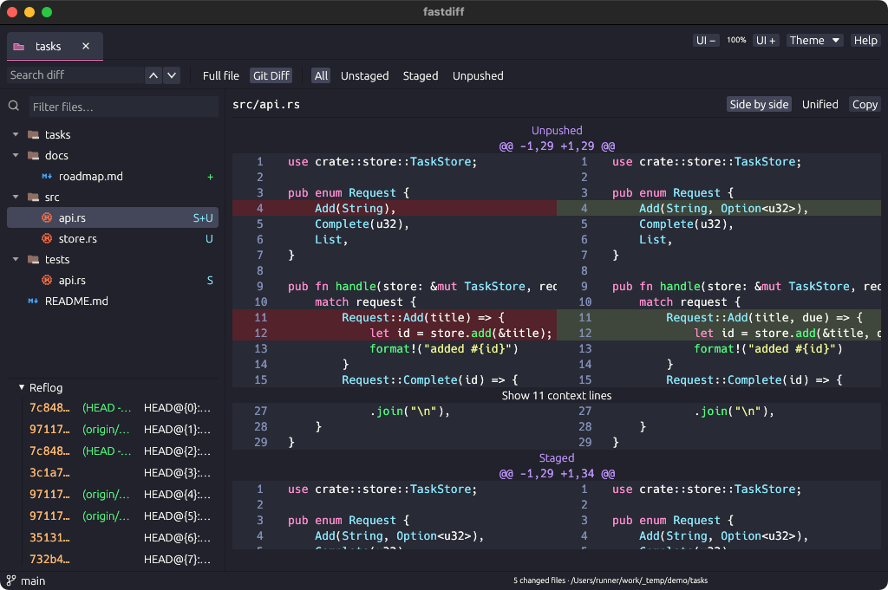
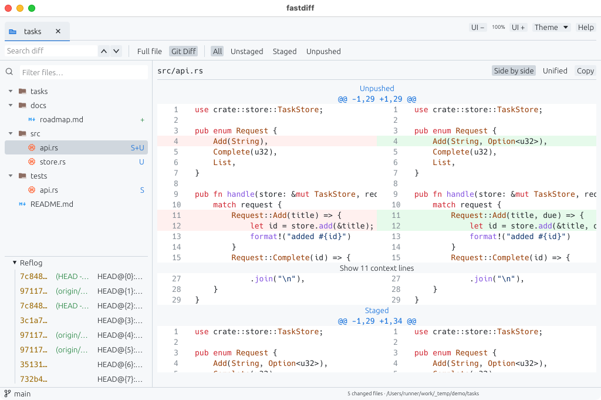

<h1 align="center">fastdiff</h1>

<p align="center">
  <b>Review your coding agent’s changes without opening an IDE.</b><br>
  fastdiff is a lightweight desktop viewer for Git changes.<br>
  Keep it open beside your terminal: your agent keeps working, and the diff refreshes as files change.
</p>

<p align="center">
  Run <code>dff</code> from your project.<br>
  Review is read-only: no editing, staging, or reverting.
</p>

<p align="center">
  <a href="LICENSE-MIT"></a>
  
  <a href="https://github.com/luisblanco93/fastdiff/actions/workflows/build.yml"></a>
</p>

<video src="https://github.com/user-attachments/assets/0ccf06d3-2c37-4ded-8359-641930450ed5" controls></video>

<p align="center">
  
</p>

## Review while your agent works

1. **Start your coding agent** in your project's terminal.
2. **Run `dff`** from another terminal in the same project to open the changed files.
3. **Keep the viewer open.** Browse files and read the diffs as your agent works; changes refresh automatically.

You can review during a task or after it finishes. fastdiff shows your repository's changes, including edits that were already there; it does not identify which agent or person made them. Share feedback in your agent conversation.

## Get started

**Ask your coding agent to install it.** Paste this prompt:

```text
Install fastdiff using the instructions for my platform at:
https://raw.githubusercontent.com/luisblanco93/fastdiff/main/docs/distribution.md
Use the released binaries; do not clone the repo, download source, or build with Rust.

Also download https://raw.githubusercontent.com/luisblanco93/fastdiff/main/skills/fastdiff/SKILL.md
to your host's supported user-level fastdiff/SKILL.md location.
Preserve existing skills and settings; report conflicts instead of overwriting.

Apply the installer's PATH guidance and verify that dff is available.
Reload your skills, or tell me if a session restart is needed.
Do not launch the app. Tell me how to run dff from my project's terminal.
```

**Prefer to install it yourself?** Follow the [installation guide](docs/distribution.md#install-fastdiff). The installer needs Python 3.11+; no GitHub CLI or Rust toolchain is required. It downloads compiled binaries and verifies them against `SHA256SUMS`.

fastdiff has native windows on Windows, macOS, and Linux. macOS requires Apple Silicon and a release with a macOS archive. WSL setup pairs the Windows app with a Linux helper. See the guide for platform requirements.

## What you can review

- **Git changes in one place.** Browse unstaged edits, staged changes, unpushed commits, and nonignored untracked files, with each comparison labeled.
- **Readable diffs.** Switch between side-by-side and unified layouts, search changes, and expand unchanged context.
- **Files and local history.** Open searchable text files, preview Markdown, and inspect the local HEAD reflog.
- **A viewer alongside your agent.** The native app stays open independently; `dff` returns after the window accepts the request. A shared [skill](skills/fastdiff/SKILL.md) lets agents with a shell open it too.

Review stays offline and leaves your source files and Git state unchanged. For recorded timings and their limits, see [performance results and measurement methods](docs/performance.md).

## Use

```bash
dff                      # review the current repository
dff /path/to/repository  # open another repository in a tab
dff . --view staged      # review staged changes
dff notes.txt            # read a text file
```

The default **All** view lists each path once and labels its Unpushed, Staged, and Unstaged comparisons separately. Binary files, conflicts, and oversized changes show an explanation when a text diff cannot be displayed. Full controls and limits are in the [usage guide](docs/usage.md).

<details>
<summary>More commands and keyboard shortcuts</summary>

```bash
dff . --view unpushed        # all | unstaged | staged | unpushed
dff . --file src/main.rs     # open one changed file
dff . --theme                # Material file icons and colored reflog
dff . --color-theme dracula  # color theme for this window (see Theme menu)
```

Navigate with <kbd>Alt</kbd>+<kbd>↑</kbd>/<kbd>↓</kbd> (files) and <kbd>Ctrl</kbd>/<kbd>⌘</kbd>+<kbd>↑</kbd>/<kbd>↓</kbd> (hunks). Search with <kbd>Ctrl</kbd>/<kbd>⌘</kbd>+<kbd>F</kbd>, filter filenames with <kbd>Ctrl</kbd>/<kbd>⌘</kbd>+<kbd>Alt</kbd>+<kbd>F</kbd>, and press <kbd>F1</kbd> for shortcut help.

</details>

<details>
<summary>More screenshots: search, Markdown preview, and color themes</summary>

<table>
  <tr>
    <td width="50%"><br><sub><b>Search.</b> <kbd>Ctrl</kbd>/<kbd>⌘</kbd>+<kbd>F</kbd> highlights every match; <kbd>F3</kbd> jumps between them.</sub></td>
    <td width="50%"><br><sub><b>Markdown preview.</b> Markdown files open rendered; <kbd>Ctrl</kbd>/<kbd>⌘</kbd>+<kbd>Shift</kbd>+<kbd>V</kbd> switches to the source.</sub></td>
  </tr>
  <tr>
    <td width="50%"><br><sub><b>Dark Modern.</b> Pick a color theme from the <b>Theme</b> menu.</sub></td>
    <td width="50%"><br><sub><b>Dracula.</b> Hovering a theme in the menu previews it.</sub></td>
  </tr>
  <tr>
    <td width="50%"><br><sub><b>GitHub Light.</b> Light and dark themes, or follow the system theme.</sub></td>
    <td width="50%"></td>
  </tr>
</table>

</details>

## For AI agents: start here

1. **Understand the tool:** this README, then [docs/usage.md](docs/usage.md) for launch options and shortcuts, and [docs/architecture.md](docs/architecture.md) for the helper protocol and refresh model.
2. **Open fastdiff for a user:** follow [skills/fastdiff/SKILL.md](skills/fastdiff/SKILL.md). To install that skill into an agent, follow [docs/distribution.md](docs/distribution.md#agent-skill).
3. **Change code:** run the focused tests for the code you touched (checks are listed under [Contributing](#contributing)). Platform and install details are in [docs/distribution.md](docs/distribution.md); measurement method is in [docs/performance.md](docs/performance.md).

Ground rules: the viewer stays read-only, launcher, GUI, and WSL helper must come from the same build, never report a check you did not run, and do not tag, bump versions, or publish without explicit maintainer approval.

## Contributing

Bug reports and focused pull requests are welcome. fastdiff builds with Rust 1.90+ (`cargo build --release --locked --workspace`); run `cargo fmt --all -- --check`, `cargo clippy --workspace --all-targets --locked -- -D warnings`, `cargo test --workspace --locked`, and `python3 -m unittest discover -s scripts -p 'test_*.py'` for the code you touch. [PRODUCT.md](PRODUCT.md) and [DESIGN.md](DESIGN.md) describe what fastdiff is and is not.

## License

Licensed under either of [Apache License 2.0](LICENSE-APACHE) or [MIT license](LICENSE-MIT) at your option. The bundled Material icons keep their own license, shipped with release archives.
