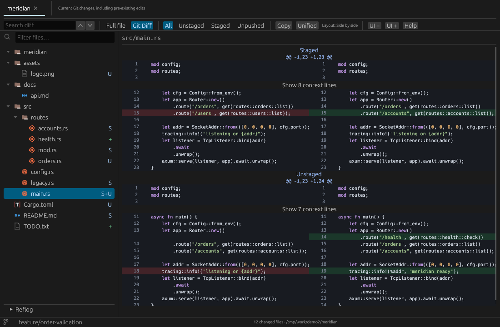
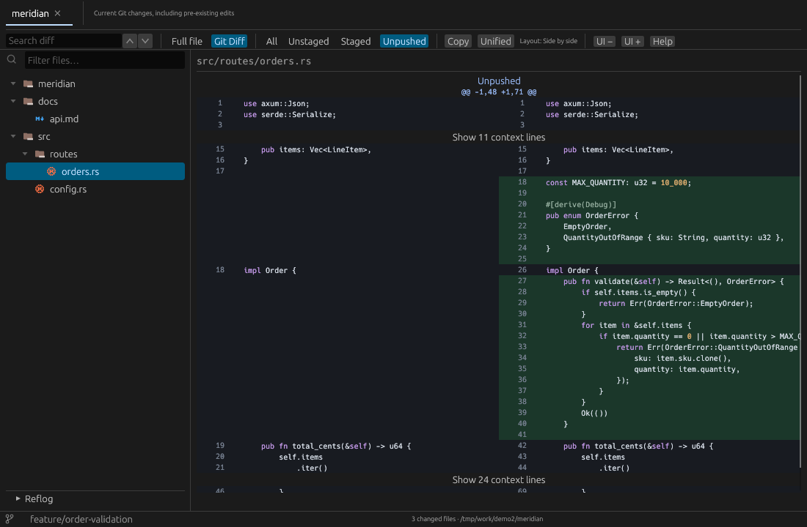
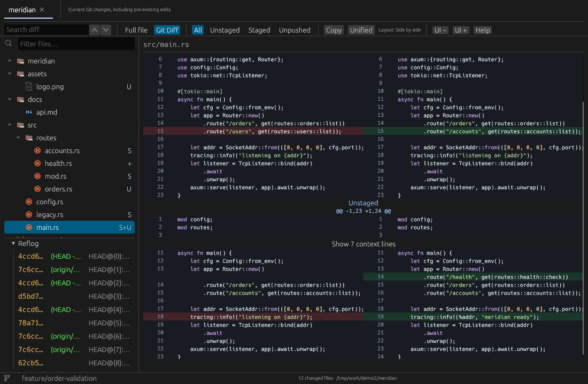
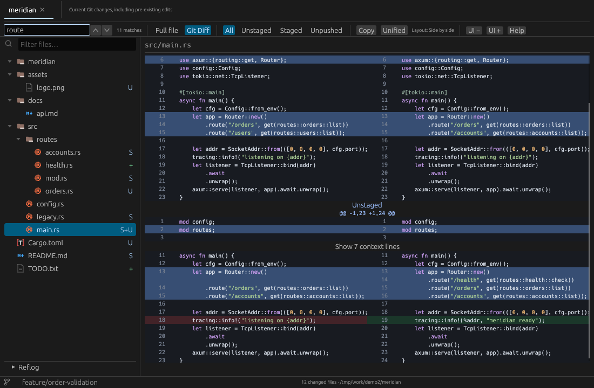
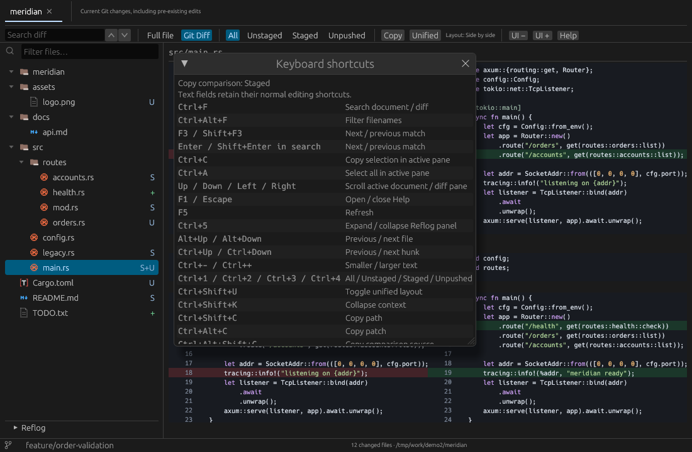

<h1 align="center">fastdiff</h1>

<p align="center">
  <b>Extremely fast, read-only viewer for Git changes.</b><br>
  Type <code>dff</code>, review the diff, get back to work.
</p>

<p align="center">
  <a href="LICENSE-MIT"></a>
  
  
  <a href="https://github.com/luisblanco93/fastdiff/actions/workflows/build.yml"></a>
</p>

<p align="center">
  
</p>

| | Launch → first frame | Launch → first diff |
| --- | --- | --- |
| **Linux window** | **73 ms** median · 192 ms worst | **181 ms** median · 331 ms worst |
| **Windows window** (repository in WSL) | 444 ms median · 607 ms worst | 642 ms median · 845 ms worst |
| **Windows window** (native, repository on NTFS) | **289 ms** median · 1,381 ms worst | **933 ms** median · 2,069 ms worst |

Recorded 2026-10-06: 30 cold launches each on an earlier build, 2-file repository, AMD Ryzen 5 3600, 4.8 GiB, Linux window under WSLg. The first-diff column uses the legacy readiness signal, which can fire before the requested diff is fully shown; the current signal is stricter, so expect somewhat higher first-diff times. Raw samples are in [docs/benchmark-linux.json](docs/benchmark-linux.json) and [docs/benchmark-wsl-windows.json](docs/benchmark-wsl-windows.json); method and targets are in [docs/performance.md](docs/performance.md). The native Windows row was recorded 2026-10-13 on a later build: 30 cold launches, 2-file repository on NTFS, Windows 11, AMD Ryzen 5 3600, 15.9 GiB, Windows Defender real-time protection on, with the strict requested-diff signal; before the startup fixes (LIT-24, LIT-25, LIT-26) the same setup measured a 2,285 ms median first diff. It is a single run, not interleaved with the baseline, and its raw samples are in [docs/benchmark-windows-native.json](docs/benchmark-windows-native.json). The Linux and WSL rows were not re-measured for the current build.

## Why fastdiff

- **Instant.** A native Rust window with virtualized rows and cached diffs. No Electron, no web view, no waiting on an IDE.
- **Everything that changed, in one place.** Unstaged, staged, unpushed commits, and untracked files, each labeled, plus the local reflog.
- **Built for coding agents.** `dff` returns as soon as the window accepts the request, so an agent can open the diff and carry on. A shared [skill](skills/fastdiff/SKILL.md) works with any agent that has a shell.
- **Read-only by design.** No staging, editing, or reverting. Opening a diff cannot change your repository.
- **Linux and Windows.** Native windows on both, with a paired helper for repositories that live in WSL.

## Install

fastdiff needs Python 3.11+ for the installer; the app itself needs no runtime, GitHub CLI, or Rust toolchain.

> **Status:** no release has been published from this repository yet. Until the first release, [build from source](#build-from-source). Once a release exists, the installer in [docs/distribution.md](docs/distribution.md#install-fastdiff) downloads the latest one and installs the terminal command `dff`.

## Use

```bash
dff                          # review the current repository (All changes)
dff /path/to/repository      # another repository opens in a new tab
dff . --view staged          # all | unstaged | staged | unpushed
dff . --file src/main.rs     # open one changed file
dff notes.txt                # searchable full-text view of any text file
dff . --theme                # Material file icons and colored reflog
```

From a source build, run `fastdiff` with the same arguments; `dff` is the command the installer creates.

**All** lists each path once and labels its Unpushed, Staged, and Unstaged comparisons separately. The default layout is side by side; switch to Unified in the toolbar. Binary files, conflicts, and oversized changes get a summary instead of a freeze.

<table>
  <tr>
    <td width="50%"><br><sub><b>Unpushed.</b> The net change of your local commits against the last fetched upstream.</sub></td>
    <td width="50%"><br><sub><b>Reflog.</b> HEAD history under the file tree, <kbd>Ctrl</kbd>+<kbd>5</kbd>.</sub></td>
  </tr>
  <tr>
    <td width="50%"><br><sub><b>Search.</b> <kbd>Ctrl</kbd>+<kbd>F</kbd> highlights every match; <kbd>F3</kbd> jumps between them.</sub></td>
    <td width="50%"><br><sub><b>Keyboard first.</b> <kbd>F1</kbd> lists every shortcut.</sub></td>
  </tr>
</table>

Files refresh automatically. Navigate with <kbd>Alt</kbd>+<kbd>↑</kbd>/<kbd>↓</kbd> (files) and <kbd>Ctrl</kbd>+<kbd>↑</kbd>/<kbd>↓</kbd> (hunks), filter the tree with <kbd>Ctrl</kbd>+<kbd>Alt</kbd>+<kbd>F</kbd>, and collapse unchanged context. Full controls and limits: [docs/usage.md](docs/usage.md).

## For AI agents: start here

1. **Understand the tool:** this README, then [docs/usage.md](docs/usage.md) for launch options and shortcuts, and [docs/architecture.md](docs/architecture.md) for the helper protocol and refresh model.
2. **Open fastdiff for a user:** follow [skills/fastdiff/SKILL.md](skills/fastdiff/SKILL.md). To install that skill into an agent, follow [docs/distribution.md](docs/distribution.md#agent-skill).
3. **Change code:** use the [build and check commands](#build-from-source) below and run the focused tests for the code you touched. Platform and install details are in [docs/distribution.md](docs/distribution.md); measurement method is in [docs/performance.md](docs/performance.md).

Ground rules: the viewer stays read-only, launcher, GUI, and WSL helper must come from the same build, never report a check you did not run, and do not tag, bump versions, or publish without explicit maintainer approval.

## Build from source

Requires Rust 1.90+ (pinned by `rust-toolchain.toml`) and Git. On Ubuntu or Debian:

```bash
sudo apt-get install build-essential pkg-config libx11-dev libxkbcommon-dev libwayland-dev libgl1-mesa-dev
cargo build --release --locked --workspace
./target/release/fastdiff /path/to/repository
```

Keep the built `fastdiff` launcher and `fastdiff-gui` together (Windows filenames end in `.exe`).

```bash
cargo fmt --all -- --check
cargo clippy --workspace --all-targets --locked -- -D warnings
cargo test --workspace --locked
python3 -m unittest discover -s scripts -p 'test_*.py'
```

## Repository map

| Path | Contents |
| --- | --- |
| `crates/fastdiff-core` | Git repositories, documents, patches |
| `crates/fastdiff-cli` | Launcher, helper process, IPC, WSL protocol |
| `crates/fastdiff-gui` | egui/eframe application and rendering |
| `install.py`, `scripts/` | Installer, runtime, packaging, benchmark tooling |
| `skills/fastdiff` | Agent skill |
| `docs/` | [Architecture](docs/architecture.md) · [usage](docs/usage.md) · [distribution](docs/distribution.md) · [performance](docs/performance.md) · [validation](docs/validation.md) · [releasing](docs/releasing.md) |

## Contributing

Bug reports and focused pull requests are welcome. Run the [build and check commands](#build-from-source) for the code you touch; [PRODUCT.md](PRODUCT.md) and [DESIGN.md](DESIGN.md) describe what fastdiff is and is not.

## License

Licensed under either of [Apache License 2.0](LICENSE-APACHE) or [MIT license](LICENSE-MIT) at your option. The bundled Material icons keep their own license, shipped with release archives.
